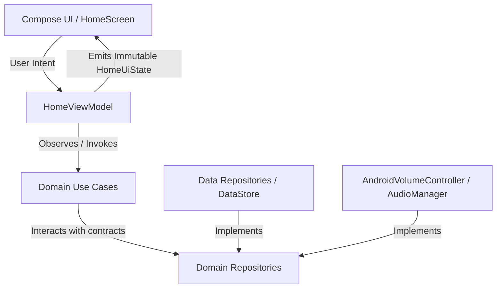

# Architecture Documentation: VolumePilot

## 1. Architectural Overview & Boundaries

VolumePilot is architected strictly following **Clean Architecture** and **MVVM with Unidirectional Data Flow (UDF)**. 

### Layer Constraints & Invariants

1. **Domain Layer (`com.volumepilot.domain`)**:
   - **Zero Android framework dependencies**: Contains only pure Kotlin models, repository interfaces, and business use cases.
   - Independent of UI, database, DataStore, or audio drivers.
   - All models (`VolumeStream`, `VolumeState`, `UserSettings`, `VolumePreset`) are immutable data classes.

2. **Data Layer (`com.volumepilot.data`)**:
   - Implements domain repository interfaces (`SettingsRepositoryImpl`, `VolumeRepositoryImpl`).
   - Backed by Jetpack DataStore Preferences for settings persistence.
   - All disk I/O runs asynchronously on `Dispatchers.IO`.

3. **Service & Audio Gateway (`com.volumepilot.service.volume`)**:
   - Bridges the Android OS `AudioManager` with domain abstractions.
   - Event-driven: Emits state changes via Kotlin `callbackFlow`.
   - Listens to broadcast actions (`VOLUME_CHANGED_ACTION`, `RINGER_MODE_CHANGED_ACTION`, `ACTION_INTERRUPTION_FILTER_CHANGED`) and `AudioDeviceCallback`.
   - Properly cleans up listeners on collection cancellation to prevent memory leaks.

4. **Floating Overlay & Foreground Service (`com.volumepilot.service.overlay`)**:
   - `OverlayService`: Android Foreground Service managing the floating `WindowManager` overlay.
   - Uses `TYPE_APPLICATION_OVERLAY` with `FLAG_NOT_FOCUSABLE` to prevent obstructing keyboard input or system navigation gestures.
   - Lifecycle: Custom `OverlayLifecycleOwner` attaches `LifecycleOwner`, `SavedStateRegistryOwner`, and `ViewModelStoreOwner` to the `ComposeView`, enabling modern Jetpack Compose within a background service.
   - Touch Engine:
     - Drag with delta tracking and touch slop detection.
     - Magnetic snapping to the nearest screen edge (left or right).
     - Tap to expand/collapse.
     - Double-tap to quick-mute.
     - Long-press to cycle active audio streams.
   - Foreground Service Compliance:
     - Declared with `android:foregroundServiceType="specialUse"` and property `PROPERTY_SPECIAL_USE_FGS_SUBTYPE` per Android 14+ (API 34+) requirements.
     - Ongoing low-priority notification with explicit pending intents for Pause/Resume and Stop actions.
     - Safe handling of `ForegroundServiceStartNotAllowedException` on Android 12+.
   - Boot Recovery:
     - `BootReceiver` listens to `BOOT_COMPLETED` and safely restores the overlay service if "Start on Boot" and overlay permissions are enabled.

5. **Presentation & Features (`com.volumepilot.feature`)**:
   - Built exclusively with Jetpack Compose and Material 3.
   - ViewModels do **not** access Android system services directly. All interactions flow through domain use cases and system permission gateways.
   - Exposes a single immutable `StateFlow` per feature screen.
   - **Onboarding (`feature/onboarding`)**: Guides new users through one-sentence value proposition, minimal permission checklist (Overlay, Notifications), and OEM battery management tips before enabling the floating button.
   - **Diagnostics (`feature/diagnostics`)**: Local-only telemetry and health monitor displaying real-time permission status, battery optimization state, service uptime, and an automated "Repair Overlay" recovery action.
   - **Profiles (`feature/profiles`)**: One-tap profile activation (Default, Sleep, Work, Driving, Meeting, Gaming, Headphones) and full custom profile creation with individual stream levels and ringer mode overrides.
   - **Automation (`feature/automation`)**: Event-driven automation control center for hardware audio device connections (Bluetooth, Wired Headphones, USB), scheduled time windows, safe listening decibel ceiling, and 100% offline JSON backup/restore.
   - **Home (`feature/home`)**: Direct volume control, stream sliders, output device detection, and preset activation.

6. **Profiles & Automation Engine (`com.volumepilot.domain.model / data.repository`)**:
   - **Volume Profiles**: Immutable `VolumeProfile` models supporting per-stream audio levels (`MEDIA`, `RING`, `NOTIFICATION`, `ALARM`), `RingerMode`, and overlay visibility states.
   - **Hardware Device Automation**: Reactive integration with `AndroidVolumeController` device callbacks to trigger custom profiles (e.g. Driving mode on Bluetooth, Headphones mode on wired headset) via `HandleDeviceConnectedUseCase`.
   - **Time-Scheduled Automation**: Battery-conscious schedule evaluation using `AlarmManager` (`TimeAutomationScheduler` & `TimeAutomationReceiver`) aligned with Android Doze maintenance windows (zero CPU wakelock). Supports multi-day recurrence and overnight midnight crossovers.
   - **Privacy-First Offline Backup & Restore**: Full JSON serialization of all profiles, automation rules, and user preferences via `BackupRepositoryImpl`. Operates completely local with zero network permissions.

---

## 2. Event-Driven Audio Engine & Battery Optimization

Traditional volume tools frequently employ polling loops or aggressive background tasks that drain battery and trigger OEM process killers. VolumePilot solves this with:

- **Zero Polling Loops**: Audio state is observed reactively through system broadcasts and `AudioDeviceCallback`.
- **Debounced Volume Updates**: User slider interactions debounce rapid inputs to avoid flooding `AudioManager.setStreamVolume()`.
- **Resource Management**: The `callbackFlow` in `AndroidVolumeController` automatically unregisters receivers and audio callbacks when the subscriber lifecycle scope cancels.
- **No WakeLocks**: The audio engine relies entirely on passive event consumption.

---

## 3. Safe Listening & Volume Limiter Engine

VolumePilot includes an optional, privacy-respecting **Safe Listening Volume Limiter**:
- Users can enable a configurable percentage threshold (e.g., 80%).
- `EnforceMaxVolumeCapUseCase` evaluates requested volume adjustments against the active stream type.
- Media and Bluetooth streams are capped to protect hearing.
- **Alarm and In-Call streams are intentionally exempt** to ensure critical alarms and emergency voice communications are never suppressed.

---

## 4. Error Handling & Local Diagnostics

- All potential runtime faults are categorized into domain `AppError` sealed classes (`StreamUnavailable`, `AudioPermissionDenied`, `VolumeLimitExceeded`, `SettingsStorageError`, `Unexpected`).
- Each `AppError` provides:
  1. `userMessage`: Plain-language explanation suitable for user display.
  2. `recoveryHint`: Concrete action the user can take to remediate the issue.
- `AppLogger` is strictly local-only:
  - Sanitizes log input.
  - Suppresses debug output in release builds.
  - Never logs personally identifiable information or user content.
  - Zero external telemetry endpoints.
