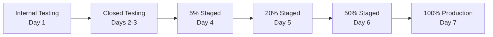

# Production Rollout Runbook: VolumePilot

This runbook establishes the exact release promotion cadence, quality metrics, and Android Vitals thresholds for launching **VolumePilot** on Google Play.

---

## 📅 1. Staged Rollout Timeline & Cadence

### Stage 1: Internal Testing Track (Day 1)
- **Cohort**: Core engineering and internal team devices.
- **Verification Focus**:
  - Smoke test: overlay appearance, dragging, edge-snapping, single-tap, double-tap, long-press.
  - Reboot survival: verify `BootReceiver` restores the overlay when "Start on Boot" is enabled.
  - Foreground notification actions: pause/resume and stop behavior.

### Stage 2: Closed Testing Track (Days 2 – 3)
- **Cohort**: 20–50 opt-in external alpha testers.
- **Verification Focus**:
  - OEM diversity soak test: Samsung (One UI 6/7), Xiaomi/Redmi (MIUI/HyperOS), OnePlus/Oppo (ColorOS/OxygenOS), Vivo (FuntouchOS), Google Pixel.
  - Verify OEM autostart / battery guidance leads to uninterrupted overlay operation.
  - Minimum soak duration: **48 continuous hours**.

### Stage 3: 5% Production Staged Rollout (Day 4)
- **Cohort**: Random 5% of all production installs/updates.
- **Monitoring Gate**: Monitor Play Console Android Vitals for 24 hours.
- **Advancement Requirement**: Crash rate < 0.1%, ANR rate < 0.05%.

### Stage 4: 20% Production Staged Rollout (Day 5)
- **Cohort**: 20% of users.
- **Monitoring Gate**: 24 hours soak. Check user review feedback for overlay disappearance or audio stream issues.

### Stage 5: 50% Production Staged Rollout (Day 6)
- **Cohort**: 50% of users.
- **Monitoring Gate**: 24 hours soak. Verify stable memory footprint and low battery usage across varied Android versions (API 26 through 35).

### Stage 6: 100% Full Production Rollout (Day 7)
- **Cohort**: All users worldwide.

---

## 📊 2. Key Quality Metrics & SLA Thresholds

Monitor these metrics in **Google Play Console -> Android Vitals** at every stage:

| Metric | Target SLA | Play Store Bad Behavior Threshold | Action If Exceeded |
|---|---|---|---|
| **Crash Rate (User-Perceived)** | **< 0.05%** | 1.09% | Halt rollout immediately if > 0.15%. |
| **ANR Rate (User-Perceived)** | **< 0.02%** | 0.47% | Halt rollout if > 0.08%. |
| **Excessive Background Wakeups** | **0.00%** | > 10 / hour | Halt rollout (check AlarmManager). |
| **Stuck Background Wakelocks** | **0.00%** | > 0.10% | Halt rollout (verify zero wakelocks). |
| **Slow Render Sessions (>16ms)** | **< 1.00%** | > 5.00% | Optimize Compose recompositions. |
| **Frozen Frame Sessions (>700ms)** | **< 0.05%** | > 0.10% | Investigate main-thread disk I/O. |

---

## 🛑 3. Rollout Halt Trigger Conditions

A staged rollout **MUST BE HALTED** immediately in Google Play Console if any of the following occur:
1. **Crash Spike**: User-perceived crash rate exceeds **0.15%** in any 6-hour window.
2. **Foreground Service Crash**: Any crash involving `ForegroundServiceStartNotAllowedException` or `WindowManager$BadTokenException`.
3. **Severe Regression**: Verified user reports of broken emergency alarm suppression or audio mute failure.
4. **OEM Systematic Failure**: High failure rate specifically clustered on a particular manufacturer (e.g. Xiaomi MIUI killing overlay on screen off).

---

## 📋 4. Daily Monitoring Routine

1. **09:00 UTC**: Check Android Vitals overview in Play Console.
2. **12:00 UTC**: Review fresh Play Store user reviews and star ratings.
3. **17:00 UTC**: Verify crash clusters in Play Console (Filter by App Version, OS Version, Device Model).
4. **If all gates pass**: Increase staged rollout percentage to next tier.
